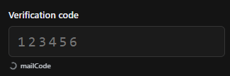

# mailCode 📧

A lightweight Chrome extension that detects verification codes in recent Gmail messages and automatically fills verification fields on websites.

## Features

- **Automatic code detection:** Finds verification codes in recent unread Gmail messages.
- **Automatic filling:** Detects verification fields and fills them when a matching code arrives.
- **Desktop notifications:** Notifies you when a new code is detected.
- **Manual actions:** Search unread emails, retrieve codes for the current page, or copy them directly.
- **Account selection:** Choose which signed-in Gmail account to use.
- **Privacy-focused:** Email data is processed locally and never sent to external servers.

## TODO 🚀

- [ ] Support more verification code formats.
- [ ] Improve code detection across different email layouts and languages.
- [ ] Improve detection of dynamically generated input fields.
- [ ] Prevent duplicate code insertion.
- [ ] Add configurable code expiration time.
- [ ] Allow users to enable or disable automatic filling.
- [ ] Add configurable notification preferences.
- [ ] Remember the user's preferred Gmail account.
- [ ] Add a keyboard shortcut to manually retrieve the latest code.
- [ ] Support other email providers (Outlook, Yahoo, etc.).
- [ ] Add support for magic login links.
- [ ] Add a temporary history of recently detected codes.
- [ ] Allow users to customize code detection rules.
- [ ] Support custom email providers through configurable integrations.